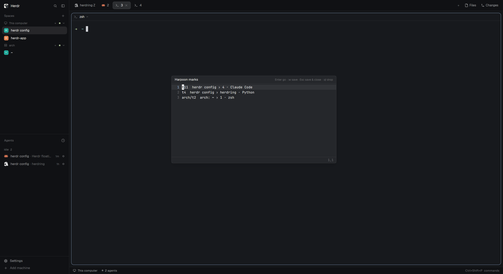

# Harpoon for Herdr

[Harpoon](https://github.com/ThePrimeagen/harpoon)-style marks for the
[Herdr](https://herdr.dev) app. Mark the terminals you keep going back to,
then jump to any of them with two keys. Marks work across machines: a terminal
on a remote Herdr machine (`arch/t2`) is marked and jumped to the same way as
a local one.


## Contents

- [What it does](#what-it-does)
  - [The marks editor](#the-marks-editor)
  - [The marks file](#the-marks-file)
- [Setup](#setup)
- [Files](#files)
- [AI Disclosure](#ai-disclosure)
- [License](#license)

## What it does

Press `ctrl-space h` and a small popup lists your marks. The next key decides:

| Keys | Does |
|---|---|
| `ctrl-space h a` | Mark the focused terminal (does nothing if it's already marked) |
| `ctrl-space h 1`–`9` | Go to that mark: selects its space and tab, focuses its pane |
| `ctrl-space h h` | Edit the marks in a floating, vim-like window |
| `esc` | Close the popup |

You can also click a mark in the popup to go to it.

### The marks editor

The editor is drawn by the mod itself (no terminal, no nvim), so it opens
instantly. It knows enough vim to reorder and delete lines:



| | |
|---|---|
| Move | `h j k l`, arrows, `0` `^` `$`, `w` `b`, `gg` `G`, `{n}G`, counts (`3j`) |
| Delete / yank | `dd` `{n}dd` `dj` `dk` `dG` `dgg`, `yy` `Y`, `p` `P` (`ddp` swaps lines) |
| Visual line | `V`, move, then `d`/`x` delete, `y` yank, `o` other end, `esc` cancel |
| Undo | `u`, `ctrl-r` |
| Commands | `:w` `:q` `:q!` `:wq` `:x` `:{line}`, `ZZ` `ZQ` |
| Extras | `Enter` goes to the mark under the cursor (saving first) |

- **`esc` in normal mode saves and closes**, like closing Harpoon's quick menu.
  Use `:q!` to drop changes; `:q` refuses while there are unsaved changes.
- There is no insert mode: add marks with `ctrl-space h a`.
- The window can be dragged and reopens where you left it.

### The marks file

Marks live in `~/.config/herdr-app/data/harpoon/marks.txt`, one per line. The
first word is the terminal address; the rest of the line is a note (space,
tab and program when the mark was added) and is ignored. Line order is slot
order. Lines starting with `#` are skipped.

```
t11  herdr config › 4 · Claude Code
t4  herdr config › herdring · Python
arch/t2  arch: ~ › 1 · zsh
```

- A mark is a terminal, not a folder. If its terminal ends, the popup shows
  `(gone)` and jumping to it shows a warning; delete it in the editor.
- A marked terminal that is running but has no pane (a sub-agent) opens with
  Herdr's peek instead.
- Each computer running the Herdr app keeps its own marks file, but marks can
  point at terminals on any connected machine.

## Setup

Requires the Herdr app (built and tested on 0.1.13 on Linux). Everything
happens on the computer that runs the Herdr app: the mod, the key binding and
the marks file all live in `~/.config/herdr-app` there. Remote machines need
nothing installed; their terminals can be marked as soon as Herdr shows them.

1. Clone this repo as a mod folder:

   ```sh
   git clone https://github.com/edgarsgogolevs/herdr-harpoon ~/.config/herdr-app/mods/harpoon
   ```

   The folder must be named `harpoon`: the popup and the editor window open
   the mod by that name.

2. Bind one key. Add this line to the `"global"` section of
   `~/.config/herdr-app/keys.json`:

   ```json
   "ctrl-space h": "mod.open:harpoon",
   ```

   This is the only binding. The popup reads the next key itself (`a`, `h`,
   `1`–`9`, `esc`), and the editor reads its vim keys itself, so neither goes
   in `keys.json`. Pick any key you like instead of `ctrl-space h`; a single
   chord such as `"alt-h"` works too. Bindings in the `global` section win
   over the terminal, so the program in the terminal no longer gets that key.

   Note: if you've never edited `keys.json`, Herdr updates it with new default
   shortcuts on upgrade. Once you edit it (even this one line), the file is
   yours and new default shortcuts have to be added by hand.

3. Check it loaded:

   ```sh
   herdr-app check ~/.config/herdr-app/mods/harpoon
   ```

   and check `herdr-app status` shows no errors (a bad `keys.json` is reported
   there and in `~/.config/herdr-app/keys.error`).

Herdr reloads mods and keys live, so there's nothing to restart. The marks
file and its folder are created the first time you mark a terminal. To update
the mod, `git pull` in its folder. To remove it, delete the folder, the
binding, and `~/.config/herdr-app/data/harpoon`.

## Files

| File | |
|---|---|
| `main.js` | The popup, the editor window, marking and jumping |
| `vim.js` | The vim emulation: pure logic, no Herdr imports |
| `mod.json` | Opens the mod as a popup at the top of the window |

## AI Disclosure

This mod was vibe coded with Claude Opus 5.5


## License

[MIT](LICENSE) © 2026 Edgars Gogoļevs
