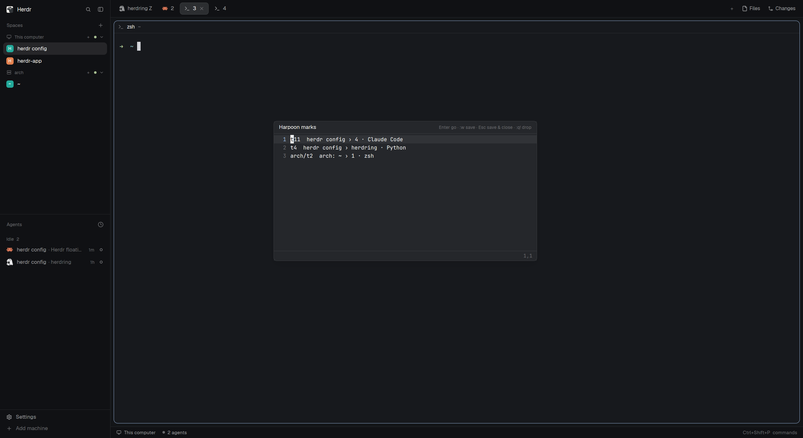

# Harpoon

Harpoon-style marks for terminals. Mark the terminals you keep going back to,
on this computer or any connected machine, then jump to one with
`ctrl-space h` and a digit. The marks are a plain list you reorder and prune
in a small vim-like window that opens instantly, drawn by the mod itself.

## What you see

**The popup** (`ctrl-space h`): a Herdr popup, 520px wide, near the top of the
window (80px down), `popover` background, 14px padding, 13px text.
- Header row: "Harpoon" (14px, semibold, `foreground`) on the left; on the
  right, key hints at 11px in `dim`: small chips `a` add, `h` edit, `1-9` go
  (chip: `raised` background, 4px radius, 5px side padding, `foreground` text).
- One row per mark, at most 9: the slot number (14px column, `accent`,
  semibold), the terminal address (70px column, `muted`, or `accent` when it
  is the focused terminal), then a live description in `foreground`:
  `<machine>: <space> › <tab> · <program>` (machine only for remote ones).
  A mark with no pane reads `(no pane, will peek)`; a dead one `(gone)`.
  Rows have 4px/8px padding, 6px radius and a `hover` background on hover.
- No marks: "No marks yet. Press a to mark this terminal." in `dim`.

**The editor** (`ctrl-space h h`): a Herdr window (`kind: "window"`) 640×340,
centered the first time, then where it was last dropped (`key:
"harpoon-editor"`), `popover` background.
- Title bar, 30px, bottom border: "Harpoon marks" (semibold), `[+]` in `dim`
  when there are unsaved changes, and on the right in 11px `dim`:
  "Enter go · :w save · Esc save & close · :q! drop".
- Lines in the terminal font (`settings().font_family`, else JetBrains Mono),
  13px, each 20px tall: a 22px right-aligned line number (`accent` on the
  cursor line, `dim` otherwise), then the text. The cursor line has a `hover`
  background; a visual-line selection has `selection`. The cursor is a block:
  the character under it drawn `background` on `foreground`.
- Status line, 24px, top border, 12px mono: `:command` with a block cursor
  while typing a command, else the last message (`-- VISUAL LINE --`,
  `3 fewer lines`, `"marks.txt" 3 marks written`, errors in `blocked`); on the
  right, pending keys/count and `row,col`.

## How it behaves

- The popup takes the keyboard when it opens. Next key: `a` marks the focused
  terminal (appends `<address>  <description>` to the marks file; does nothing
  if that address is already marked) and toasts "Harpoon N"; `1`–`9` goes to
  that mark; `h` opens the editor; `esc` closes. Clicking a row goes to it.
- Going to a mark: find the pane showing that terminal in `panes()`, then
  `space.select {id}` (if not shown), `tab.select {id}` (if not shown),
  `pane.focus {pane}`. Works the same for remote terminals (`arch/t2`).
  A live terminal with no pane opens with `terminal.peek`; a missing one
  toasts "`<address>` is gone" (warning).
- The editor focuses its own focus handle (windows don't take the keyboard by
  themselves). It is a line-oriented vim with no insert mode:
  `h j k l`, arrows, `0 ^ $`, `w b`, `gg G {n}G`, counts; `dd {n}dd dj dk dG
  dgg`, `yy Y`, `p P` (linewise register; `ddp` swaps lines); `V` visual line
  with motions, `d`/`x`, `y`, `o`, `esc`; `u`, `ctrl-r`; `:w :q :q! :wq :x
  :{line}`, `ZZ ZQ`.
- `esc` in normal mode saves (if changed) and closes; `:q` refuses with E37
  while there are unsaved changes; `:q!` / `ZQ` drop them. `Enter` saves and
  goes to the mark under the cursor. Closing returns focus to the pane that
  was focused when the editor opened.
- Agent statuses (working, blocked, done, idle) are not shown: a mark is just
  a terminal, whatever runs in it.

## Built from

- One mod, `mods/harpoon/`, `mod.json`:
  `{ "place": "none", "overlay": { "kind": "popup", "at": "top", "offset": 80, "width": 520 } }`.
  Opened by the key `"ctrl-space h": "mod.open:harpoon"` (see `keys.json`).
- `main.js`: the default `View` dispatches on `props().role`: none → the
  popup, `"editor"` → the editor. The popup opens the editor with
  `openOverlay({ kind: "window", key: "harpoon-editor", width: 640, height: 340,
  mod: "harpoon", props: { role: "editor", text, pane } })`, passing the file
  text it just read so the window draws at once, then closes itself.
- `vim.js`: the vim emulation as a plain class (`new Vim(text)`,
  `key(name)` → null or `{action: "close" | "save" | "jump"}`), no Herdr
  imports, so it can be tested with node. Keys are named from the key event:
  `ctrl-<key>` with control, else `key_char` when it is one character (so `$`,
  `V`, `G` arrive as typed), else `key` (`escape`, `enter`, `space`).
- Marks file: `<appHome()>/data/harpoon/marks.txt`, one mark per line, first
  word = terminal address, rest ignored, `#` lines skipped. Read with
  `readTextFile`, written with `writeTextFile(path, text, expected)` (stale
  writes rejected), folder made with `fs/promises` `mkdir({recursive: true})`.
- Herdr functions: `panes`, `spaces`, `terminals`, `focused`, `theme`,
  `settings`, `props`, `run`, `openOverlay`, `closeOverlay`, `notify`,
  `appHome`, `readTextFile`, `writeTextFile`. Commands: `space.select`,
  `tab.select`, `pane.focus`, `terminal.peek`. No programs run, no network.

## Watch out

- A terminal inside an overlay (a window or dialog with a `{terminal}` block)
  can't be given the keyboard by a mod: `pane.focus {terminal}` fails with "no
  such pane" and `window.focus_next()` doesn't reach it. That's why the editor
  is drawn by the mod instead of running nvim. `terminal.peek` of a terminal
  started a moment ago with `hc run` also fails until `terminals()` lists it.
- `<mod>.<command>` keys only reach a mod copy that is shown, so per-slot keys
  can't go straight to a hidden mod; the popup reading the next key is what
  makes `ctrl-space h 1` work with one binding.
- Windows are dragged by any press the mod doesn't stop; the editor has no
  clickable controls, so the whole window drags.
- Esc in a popup: handle it in `on_key_down` and stop propagation.
- The mod must be named `harpoon`: the popup opens the editor by that name.
- Marks are terminal addresses, so a mark dies with its terminal (a lost
  terminal that Herdr replaces with a shell keeps its address).
- Only slots 1–9 are shown and reachable by key; the file can hold more.

## Done when

- `herdr-app check mods/harpoon` passes and `herdr-app status` shows no errors.
- `ctrl-space h` shows the popup with the marks file's first 9 addresses and
  live descriptions; `esc` closes it.
- `ctrl-space h a` in a terminal adds one line to `data/harpoon/marks.txt`;
  pressing it again in the same terminal adds nothing.
- `ctrl-space h 2` from another space selects the right space and tab and
  focuses the marked pane, including a terminal on a remote machine.
- `ctrl-space h h` opens the editor immediately and typing `j` moves the
  cursor without clicking first.
- In the editor, `ddp` swaps two lines, `Vjd` deletes two, `u` undoes,
  `:q` with changes shows E37, `esc` writes the file and closes, and the
  popup then shows the new order.
